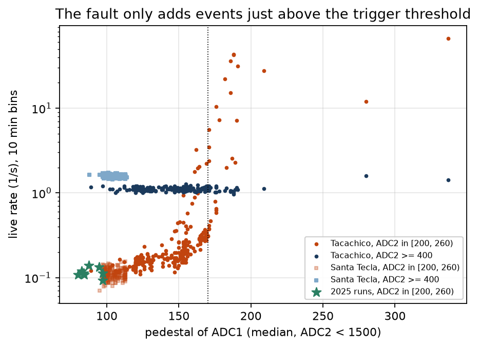
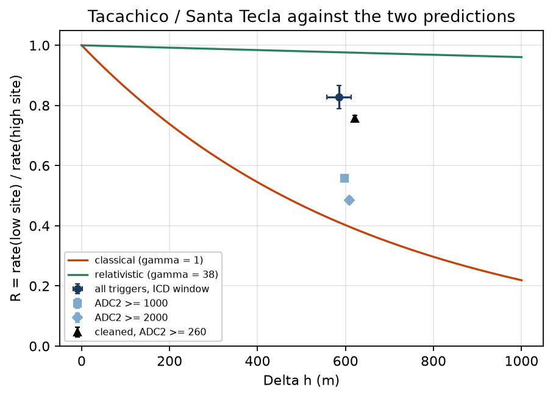
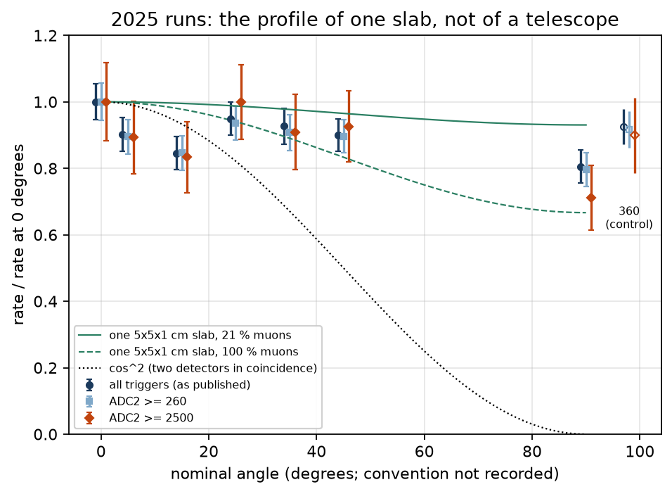
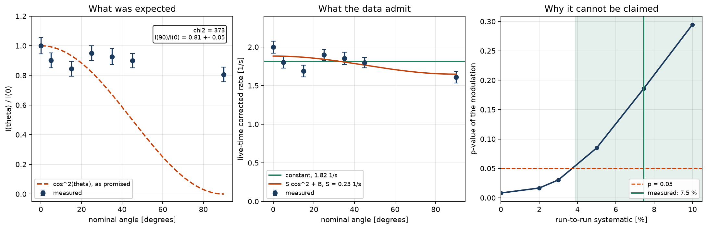
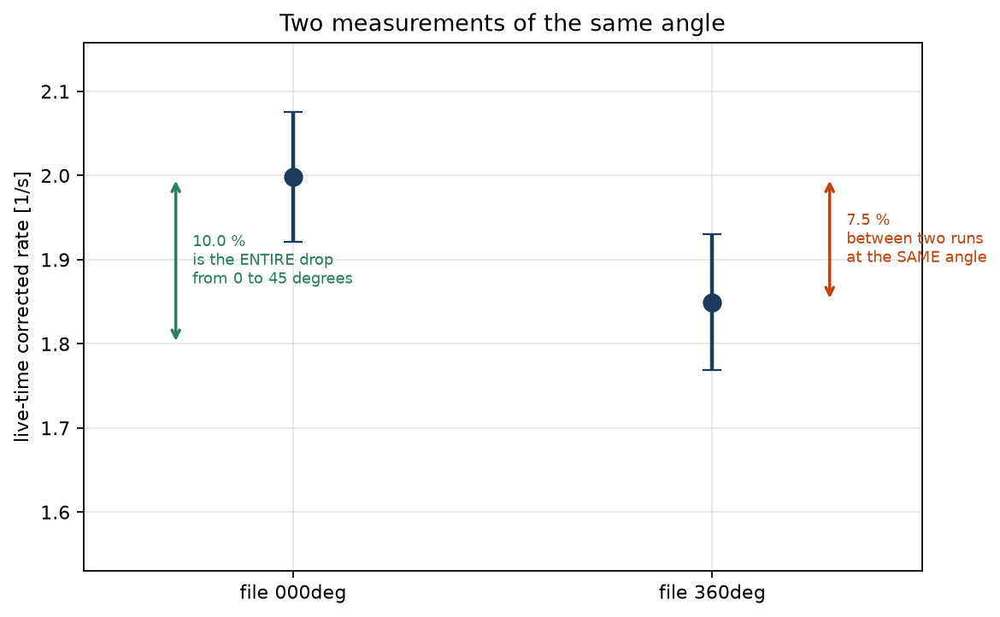

# Muon flux analysis

The cosmic muon rate against angle and against altitude, measured with a
CosmicWatch-type desktop scintillator detector, and how to tell a faulty
detector from a working one using nothing but the files it writes.

Two campaigns, the same detector design and firmware:

| Campaign | What | Data |
|---|---|---|
| 2025, angular | seven nominal angles plus a repeatability control, about six minutes each | 4760 events, 256 kB |
| 2026, altitude | Tacachico (about 307 m) and Santa Tecla (about 911 m), El Salvador | 40.9 h and 32.1 h, 590 389 events, 33 MB |

The 2026 data were taken by a student group of the Universidad de El Salvador
for the International Cosmic Day 2026, and are published here with the group's
permission.

## Results

### 1. The 2026 detector fault can be recognised and removed

The 2026 detector had a loose board that, in some positions, sends it into a
high-rate state: ten episodes in the Tacachico file, 43 % of its events. Nothing
in the files flags it, and two readings per event are enough to see it
(`SiPM[mV]` turns out to be an exact function of the other two):

- **Burst**: the low-gain channel reads more than the high-gain one,
  `ADC1 > ADC2`, which a real pulse never does (0 to 0.1 % of events in clean
  data). In the burst of minutes 70 to 73 it does so in 97 % of events, at 133.5
  events/s; one episode is a full burst and two more are partly one.
- **Slow fault**: the baseline (pedestal) of the low-gain channel rises and the
  extra events pile up just above the trigger threshold: that band grows 183
  times while the total grows 17 times and the bands above `ADC2 = 400` change by
  -15 % to +27 %.

A veto on the state of each minute plus the cut `ADC2 >= 260` takes the hourly
Tacachico rate from chi-square 143 736 / 38 to 55.5 / 35 and lets the whole
acquisition in. It is close to constant, not constant: a 1.2 % excess over
Poisson remains, and the reference window and the other hours still differ by
1.8 % (3.3 sigma); the cleaned ratio below carries that residual as its
systematic. The thresholds were chosen looking at that file, so this is a
consistency check, not a blind test.
Details in [docs/detector_fault.md](docs/detector_fault.md).



### 2. Rate against altitude

| | As presented at the ICD 2026 | After cleaning |
|---|---|---|
| Tacachico | hours 26 to 40, every trigger | whole acquisition, veto, `ADC2 >= 260` |
| Ratio R = rate(307 m) / rate(911 m) | **0.828 +- 0.004 (stat) +- 0.038 (hours)** | **0.757 +- 0.003 (stat) +- 0.009 (hours)** |
| Delta h from the detector's own pressure | 603 +- 28 m | same |
| Classical prediction (gamma = 1) | 0.40 +- 0.02, 10 sigma away | 18 sigma away |
| Relativistic, decay only (gamma = 38) | 0.976 +- 0.001 | same |
| gamma_min (95 % lower bound) | 4.8 +- 1.2 (3.2) | 3.3 +- 0.2 (3.0) |

Taken at face value, the classical expectation is excluded. **It cannot be taken
at face value**: counting the 25 cm2 face only, as presented, a single
detector sees 0.32 to 0.42 muons/s, so only 16 to 26 % of its triggers can be
muons (the edges of a 1 cm slab add about a fifth). If the rest does not depend on
altitude, the classical prediction rises to 0.87 to 0.90; and the ratio falls
from 0.83 to 0.48 as the ADC2 threshold rises, which muons alone would not do.
These data cannot decide between the two predictions. The two columns are
different observables and are never combined (methodology 11.7). Altitudes from pressure: 307 +- 21 m and 911 +- 26 m, within
10 m of the published ones.



### 3. The 2025 angular runs, read again

The first reading (below) found the profile flat and could not say why. With
what the 2026 campaign taught:

- **They were not taken in the fault state.** No 2025 event reads
  `ADC1 > ADC2`, no minute is vetoed, the near-threshold rate equals that of the
  cleanest 2026 state. Cleaning them changes nothing: `I(90)/I(0)` goes from
  0.806 +- 0.049 to 0.796 +- 0.050.
- **They are not coincidences.** About 2 events/s, every one with
  `Coincident = 1`, where two stacked slabs see at most 0.32 coincidences/s.
  Whatever the flag (and the `Coincidence detector found.` of each preamble)
  means, these are the triggers of one detector; the 2026 detector raised the
  same flag for hours without a partner, according to the group that took the
  data. `cos^2(theta)` is the reference for a coincidence telescope, not for
  them.
- **One slab does not fall to zero.** For an assumed 5 x 5 x 1 cm slab, even
  pure muons fall only to 2/3 at 90 degrees. With 19 to 25 % muons (the known
  flux over the same box) the expected `I(90)/I(0)` is 0.92 to 0.94; the
  measured 0.806 is 1.4 sigma below once the 7.45 % run-to-run systematic is
  included, and the fitted muon fraction, 0.36 [0.23, 0.49], overlaps the
  expected one. Above larger ADC2 cuts the profile changes shape, and above
  saturation it even rises over 1 at intermediate angles: tilting the slab
  lengthens the path of near-vertical muons, so an amplitude cut is not a muon
  filter of fixed efficiency and those profiles are not fitted.

The flat profile is what this setup should give. Measuring `cos^2` needs a
working coincidence.



### The first reading of the angular runs (2026-08-10)

Published before the 2026 campaign and kept as it was. Its numbers stand; its
explanation of the flat profile is superseded by result 3.

**This setup did not measure the angular dependence of the muon flux.** The
fraction of flux modulated as `cos^2(theta)` is bounded at

> **< 25.4 % at 95 % confidence**, systematic included.

The data on their own prefer a modulated component of about 12 %, significant
at p = 0.008 under pure counting statistics. **That preference does not
survive.** A run-to-run systematic of 3.88 % is enough to cancel it, and the
repeatability control in this very data set measures **7.45 %**, nearly twice
that. With the measured systematic folded in, p = 0.19.

| | |
|---|---|
| Difference between two runs at the **same** angle | **7.45 %** |
| The **entire** drop from 0 to 45 degrees | 10.0 % |





| Quantity | Value |
|---|---|
| Events analysed | 4760, across 8 runs |
| Constant rate | 1.816 [1.788, 1.844] 1/s at 68 % |
| I(90)/I(0) measured | 0.806 +- 0.049 |
| I(90)/I(0) predicted by `cos^2` | 0 |
| chi-square against pure `cos^2`, 7 points | 372.9 |
| Modulated fraction, best fit | 12.5 % |
| Modulated fraction, 95 % upper bound | **25.4 %** |
| Run-to-run systematic, measured | 7.45 % |
| Systematic that cancels the significance | 3.88 % |

---

## Contents

- [Results](#results): the fault, the altitude comparison, the angular runs read again
- [What the previous version of this repository published, and why it was wrong](#what-the-previous-version-published)
- [Why the flux looks flat](#why-the-flux-looks-flat)
- [Repository layout](#repository-layout)
- [Reproducing the analysis](#reproducing-the-analysis)
- [Documentation](#documentation)
- [Limitations](#limitations)
- [License](#license)

---

## What the previous version published

This section is about the version before the first reading above. Until 2026-08-10 this repository fitted `I(theta)/I(0) = cos^n(theta)` and
reported **n = 0.006**. That number was double-precision rounding, not physics.

`np.cos(np.deg2rad(90))` does not return zero. It returns 6.123e-17. Raised to a
small exponent that is a number of order one:

```
cos(deg2rad(90)) ** 0.01 = 0.688
```

So the grid search found a minimum pinned to the bottom edge of its range, and
the exponent it reported was set by how a floating-point residue behaves under
exponentiation. Two symptoms show how little it meant:

- Dropping the single point at 90 degrees moved the exponent from 0.006 to
  0.364, a factor of 64.
- The exponent depended on whether the grid search refined its minimum: the
  coarse grid gave 0.010, the refinement 0.006. A parameter whose value moves by
  75 % with an implementation detail of the optimiser is not measuring anything.

**Clamping `cos(90)` to exact zero does not fix the fit. It removes it.** With
`cos(90) = 0`, every `cos^n` with n > 0 predicts exactly zero counts at 90
degrees, where 446 intervals were observed. The likelihood is rigorously zero:
`-logL` diverges, and there is no AIC or BIC to compare. The 6.123e-17 was the
only reason the model could be fitted at all.

Other defects corrected in the same pass, each of which changed a published
number:

| Defect | Effect |
|---|---|
| `DeadTime` column parsed and never used | every rate 10 % low |
| Rate estimated as `N/T` instead of `(N-1)/T` | biased high by 1/N |
| Run duration truncated to a whole multiple of `--bin-seconds` | a cosmetic flag moved the published rate by 0.4 % |
| chi-square over ratios sharing a denominator | correlations ignored entirely |
| 0 degree point counted in the degrees of freedom | reduced chi-square understated |
| `sigma = 1.0` substituted for missing errors, `max(dof, 1)` | manufactured a reduced chi-square out of nothing |
| Malformed lines dropped by `except Exception: continue` | one real malformed line, never reported |
| Column order guessed by magnitude, per row | the file header declares the wrong order and nothing said so |

The six usage examples in the old README all invoked `--data-dir second`, a
directory that exists in no commit in the repository's history.

---

## Why the flux looks flat

The measured profile is flat and not even monotonic: it falls to 0.845 at 15
degrees and rises to 0.950 at 25. No `cos^n` with n > 0 can rise anywhere, so
if that rise were real it would rule out the entire family. On its own the rise
is worth 1.47 sigma, which is not enough to assert it; the chi-square of 372.9
is what carries the conclusion.

The first reading left three explanations open: wide geometric acceptance, an
accidental component, and an undocumented angular convention. The 2026 campaign
settles the first two (result 3). The record holds the singles of one detector,
not coincidences, so most triggers are not muons; and a single slab keeps two
thirds of its muon rate at 90 degrees. Together they predict a profile about as
flat as the one measured. The angular convention is still unrecorded. See
[docs/dataset.md](docs/dataset.md) sections 3.3, 4.1 and 5, and step 08.

---

## Repository layout

```
muon-flux-analysis/
  README.md                     this document
  docs/
    methodology.md              numbered, citable analysis rules
    dataset.md                  what is known and, above all, what is not
    detector_fault.md           the 2026 fault and how to tell it apart
  scripts/
    00_ingest.py                read and inventory the 2025 runs
    01_validation.py            data quality gate
    02_rates.py                 live-time corrected rates
    03_timeseries.py            per-run stability
    04_normalization.py         I(theta)/I(0) and the cos^2 contrast
    05_fits.py                  Poisson likelihood inference
    06_systematics.py           systematics and the reassessment
    07_detector_health.py       the 2026 fault, its cleaning, the 2025 runs checked
    08_angular_reading.py       the 2025 runs against a single slab
    09_altitude.py              Tacachico against Santa Tecla
    90_report_figures.py        figures of the first reading, from results/ only
    check_reproducibility.py    published results against a fresh run
    lib_muon/                   shared library
  results/
    tables/  fits/  figures/    versioned products, _vN
  data/raw/                     the eight 2025 runs, 256 kB
  data/raw/altitude_2026/       the two 2026 acquisitions, 33 MB
  tests/                        152 tests, including the full pipeline
  requirements.txt              pinned versions
```

Conventions, described in full in [docs/methodology.md](docs/methodology.md)
section 6:

- **The numbering is the execution order.** 00 to 09 analyse, 90 and above
  present and perform no fitting.
- **No script overwrites a result.** Each run writes `_vN`; the suffix lives in
  the product, never in the script name.
- **Results are versioned.** Every figure and table in this README is in the
  repository, and every number in it is traceable to the run that produced it.
- **Every JSON carries** the commit hash, the parameters and the seed.
- Products come paired: `.json` and `.txt` for tables, PDF and PNG for figures.

---

## Reproducing the analysis

Requires Python 3.11 or newer.

```bash
python3 -m venv .venv
.venv/bin/pip install -r requirements.txt
```

### Check the published numbers

To verify that everything in this README reproduces on your machine, this is the
whole procedure:

```bash
.venv/bin/python scripts/check_reproducibility.py
```

It runs the entire pipeline into a temporary directory, compares every numeric
leaf of its output against the `_v1` products committed here, and removes the
temporary directory afterwards. It needs no prior step and does not touch
`results/`. Expect this, in about half a minute:

```
[check] 00_ingest: reproduces exactly
...
[check] OK: 11 product(s) compared, all reproduce within rtol=1e-06, atol=1e-12.
```

Exit codes are `0` if every number reproduces, `1` if any disagrees beyond
floating-point noise or the repository publishes nothing to compare against, and
`2` if the pipeline itself failed to run. The three cases are distinguished on
purpose: "nothing was compared" is not the same claim as "the results do not
reproduce", and reporting the second when the first is true would be exactly the
sort of thing this repository exists to correct.

### Run the pipeline yourself

In order, from the repository root:

```bash
.venv/bin/python scripts/00_ingest.py
.venv/bin/python scripts/01_validation.py
.venv/bin/python scripts/02_rates.py
.venv/bin/python scripts/03_timeseries.py
.venv/bin/python scripts/04_normalization.py
.venv/bin/python scripts/05_fits.py
.venv/bin/python scripts/06_systematics.py
.venv/bin/python scripts/07_detector_health.py
.venv/bin/python scripts/08_angular_reading.py
.venv/bin/python scripts/09_altitude.py
.venv/bin/python scripts/90_report_figures.py
```

Each script writes a new `_vN` alongside the committed results rather than
replacing them, so your run and the published one coexist and can be diffed.

Tests:

```bash
.venv/bin/pytest tests/
```

The suite includes a regression test for the `cos(90)` defect, recovery of a
known exponent from synthetic data, a rate checked against a hand-computed case,
the closed forms of the single-slab response, the row counts of the 2026 files,
every fault episode under the veto, and an end-to-end run of the whole pipeline
that pins the numbers quoted here. CI runs all of it plus the full
pipeline on the real data, on Python 3.11 and 3.13.

---

## Documentation

- **[docs/methodology.md](docs/methodology.md)**: the analysis rules, numbered
  so code and report can cite them. Includes the mandatory rule that every
  candidate systematic is compared against its own Poisson expectation before
  entering the budget (rule 5.1), which is what keeps statistical fluctuation
  from being reported as a systematic.
- **[docs/dataset.md](docs/dataset.md)**: the files, the format, the known
  defects, section 4 on what is not recorded about the setup, and section 7 on
  the 2026 campaign.
- **[docs/detector_fault.md](docs/detector_fault.md)**: the evidence for the
  2026 fault in the data, the cleaning and its validation, and a check to run
  on a detector before using it.

---

## Limitations

1. **The scintillator was never measured.** The single-slab reference assumes
   5 x 5 x 1 cm; at 90 degrees it gives 0.59 for 0.5 cm and 0.79 for 2 cm. No
   rate is corrected with it, and above amplitude cuts it does not apply.
2. **The 2025 coincidence did not work.** The record holds singles, so no
   angular result here can test `cos^2`.
3. **The angular convention is not documented.** The mapping from file labels to
   physical angles is assumed, not known.
4. **One repeatability control, at 1.33 sigma.** The dominant systematic of the
   angular runs rests on a single repeated measurement.
5. **Triggers are not muons.** Every ratio and every gamma_min of the altitude
   comparison assumes they are; a single detector counts 16 to 26 % muons.
6. **A fixed ADC2 cut is not a fixed energy.** The gain of the sensor falls as
   the case warms up, so cuts compare different thresholds at the two sites.
7. **The cleaning was tuned on the file it cleans.** Its validation is a
   consistency check, and a detector with other settings needs its own.
8. **Not recorded in 2026**: GPS, dates, orientation, the roof above the
   detector, and whether it is the unit that took the 2025 runs.

What would be needed to do better, in order of value, is in
[docs/dataset.md](docs/dataset.md) section 6.

---

## License

MIT. See [LICENSE](LICENSE).

Raw data recorded with desktop muon detectors of the
[CosmicWatch](http://www.cosmicwatch.lns.mit.edu/) design.
